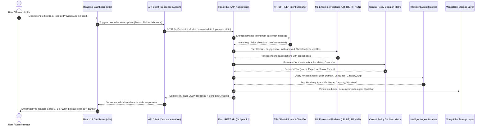
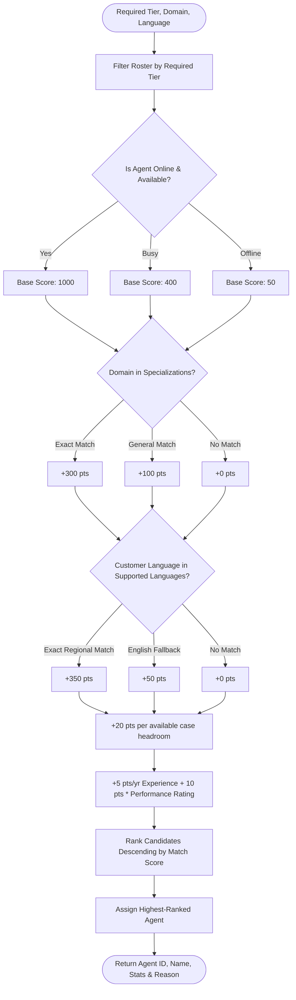

# salesInternAi — Comprehensive System Architecture & Engineering Documentation

> **Platform Version:** 2.0.0  
> **Architecture:** Multi-Model Explainable AI Customer Classification & Intelligent Agent Routing  
> **Status:** Production-Ready / Fully Verified  
> **Stack:** React 18 (Vite), Flask 3.0, Scikit-Learn 1.5, MongoDB / Persistent Fallback, Python 3.10  

---

## 1. Executive Summary & Core Business Objectives

**salesInternAi** is an enterprise-grade AI customer classification and automated routing system inspired by digital insurance aggregators such as Policybazaar. The system dynamically evaluates customer demographic profiles, digital browsing behavior, interaction friction signals, and inbound conversation intent to predict insurance requirements and match the customer with the most qualified, available agent in real time.

### Core Business Objectives:
1. **Maximize Customer Conversion:** Connect high-intent buyers immediately with fast-turnaround Intern agents, while routing hesitant customers with price or trust objections to consultative Expert agents.
2. **Optimize Senior Resource Utilization:** Protect high-cost Senior Experts from routine inquiries, reserving them strictly for high-complexity, multi-line policies, underwriting risks, or escalated cases where previous interactions failed.
3. **Eliminate Misrouting and Silent Downgrading:** Enforce mandatory tier integrity so complex cases are never routed to unqualified interns simply because purchase willingness is high.
4. **Real-Time Explainability & Transparency:** Refuse black-box scores. Every prediction provides its own probability distribution, underlying feature drivers, decision boundary tracking, and plain-English operational reasoning.
5. **Native Cultural & Regional Alignment:** Match customers with agents fluent in their preferred language (English, Hindi, Telugu, Tamil, Kannada, Marathi, Bengali, Gujarati) alongside required domain specializations.

---

## 2. End-to-End High-Level System Architecture

The following Mermaid sequence diagram outlines the entire request, inference, policy enforcement, matching, and persistence lifecycle:



---

## 3. Data Engineering & Synthetic Dataset Generation

To train, validate, and benchmark the machine learning models at enterprise scale, a synthetic dataset generator was implemented in `backend/data/generate_dataset.py`.

### 3.1 Design Principles
- **Scale:** 100,000 distinct customer records.
- **Zero Duplicate IDs:** Enforced unique customer identifiers (`CUST100000` to `CUST199999`).
- **Reproducibility:** Global random seed locked to `42` (`numpy.random.seed(42)` and `random.seed(42)`).
- **Realistic Statistical Distributions:**
  - **Age:** Discrete uniform distribution between 18 and 75 years.
  - **Monthly Income:** Continuous log-normal distribution ($\mu=11.0, \sigma=0.6$) bounded between ₹15,000 and ₹500,000 to mirror Indian urban demographics.
  - **Credit Score:** Gaussian distribution ($\mu=710, \sigma=80$) clipped between 320 and 850.
  - **Controlled Missing Values:** Realistic ~1.5% non-critical missing values in `monthly_income`, `credit_score`, and `chat_count` to train and evaluate Scikit-Learn's `SimpleImputer`.

### 3.2 Customer Behavioral Archetypes
Rather than generating independent random numbers (which destroys feature correlations), the generator simulates 6 behavioral archetypes:

| Archetype ID | Persona Description | Behavioral Profile | Typical Routing Outcome |
|:---:|---|---|---|
| **0** | **Direct Willing Buyer** | Single category focus, high dwell time, low doubts, 1–3 quote requests, callback requested. | Intern Agent |
| **1** | **Multi-Category Comparer** | Views across Health, Life, and Vehicle; moderate questions and doubts; comparing terms. | Expert Agent |
| **2** | **Price / Trust Objector** | Multiple visits, high dwell time, express price or claim skepticism in message, 0 quotes. | Expert Agent |
| **3** | **High-Complexity Case** | High cross-domain browsing, 5+ doubts, 6+ questions, critical illness or rider inquiries. | Senior Expert Agent |
| **4** | **Service Escalation** | `previous_agent_failed = True`, conflicting advice received, elevated risk score. | Senior Expert Agent |
| **5** | **Casual Browser** | Single session, 1–2 views, minimal dwell time, no message or general enquiry. | Nurture / Low Engagement |

### 3.3 Synthetic Agent Roster (40 Agents)
A realistic workforce of 40 agents was synthesized (`backend/data/synthetic_agents.csv`) spanning 3 tiers:
- **14 Intern Agents (`AG101` – `AG114`):** Experience 0.5–2.0 years, maximum capacity 4 simultaneous cases.
- **16 Expert Agents (`AG115` – `AG130`):** Experience 2.5–5.0 years, maximum capacity 5 simultaneous cases.
- **10 Senior Expert Agents (`AG131` – `AG140`):** Experience 5.5–14.0 years, maximum capacity 6 simultaneous cases.
- **Multilingual Roster:** Agents speak English plus primary regional Indian languages (Hindi, Telugu, Tamil, Kannada, Marathi, Bengali, Gujarati).
- **Availability State:** 85% online, with live availability status (`Available`, `In Call`, `On Break`, `Offline`).

---

## 4. Input Feature Space & Anti-Bias Framework

The platform accepts 22 input variables across 3 functional groups:

### Group A: Customer Demographic & Policy Profile
1. `age` (integer, 18–90): Informs age-appropriate coverage without biasing complexity.
2. `monthly_income` (float, INR): Affordability context; never used to disqualify customer.
3. `credit_score` (integer, 300–850): Underwriting indicator; never used to escalate complexity.
4. `marital_status` (string: *Single, Married, Divorced, Widowed*): Family floater vs individual context.
5. `dependents` (integer, 0–8): Sizing of life and health insurance coverage.
6. `existing_policy` (boolean): Portfolio portability indicator.
7. `selected_category` (string: *None, Health, Life, Vehicle, General*): Explicit customer preference.

### Group B: Customer Browsing Behavior
8. `health_page_views` (int) & `health_time` (seconds): Engagement with Health products.
9. `life_page_views` (int) & `life_time` (seconds): Engagement with Term Life and ULIP products.
10. `vehicle_page_views` (int) & `vehicle_time` (seconds): Engagement with Comprehensive Motor products.
11. `general_page_views` (int) & `general_time` (seconds): Engagement with Travel/Home products.

### Group C: Interaction Friction & Conversational Signals
12. `total_sessions` (int, $\ge 1$): Frequency of visit sessions.
13. `return_visits` (int, $\ge 0$): Retention and re-engagement indicator.
14. `quote_requests` (int, $\ge 0$): Direct commercial intent.
15. `callback_requests` (int, $\ge 0$): Direct sales consultation request.
16. `chat_count` (int, $\ge 0$): Chatbot interaction volume.
17. `doubts` (int, $\ge 0$): Specific objections or ambiguities recorded.
18. `questions` (int, $\ge 0$): Specific policy questions asked.
19. `risk_score` (int, 0–100): Service or case risk assessment.
20. `previous_agent_failed` (boolean): Hard escalation trigger when a previous rep could not resolve the issue.
21. `language` (string): Preferred language for agent matching.
22. `customer_message` (string): Free-text message analyzed by the NLP Intent Classifier.

> [!IMPORTANT]
> **Anti-Bias Guarantee:**
> Age, monthly income, and credit score **never** independently cause escalation to Senior Expert or make a customer "complex". Underwriting indicators serve solely to provide financial consultation context. Escalation is governed strictly by case complexity, interaction friction, and service rules.

---

## 5. Machine Learning Architecture & 5-Stage Classification

PolicyBuzar trains 4 core supervised algorithms plus a soft-voting ensemble for each classification task:
1. **Logistic Regression (LR):** Linear baseline with L2 regularization ($C=1.0$).
2. **Decision Tree (DT):** Non-linear rule inducer (`max_depth=8` to `12`).
3. **Random Forest (RF):** Bagged ensemble of 40–50 randomized estimators.
4. **K-Nearest Neighbors (KNN):** Distance-based instance learning ($k=5$ or $7$).
5. **Soft-Voting Ensemble:** Combines predicted probabilities across all 4 algorithms:
   $$P_{\text{ensemble}}(c) = \frac{1}{M} \sum_{m=1}^{M} P_m(c)$$

### Model Evaluation Benchmark (On Test Split)

| Prediction Task | LR Accuracy | DT Accuracy | RF Accuracy | KNN Accuracy | Voting Ensemble | Primary Metric Focus |
|---|:---:|:---:|:---:|:---:|:---:|---|
| **Insurance Domain** | 94.4% | 95.0% | 95.5% | 94.7% | **95.6%** | Multi-class Macro F1 |
| **Customer Engagement** | 92.1% | 89.4% | 91.8% | 90.5% | **92.7%** | Ordinal Balanced Accuracy |
| **Purchase Willingness** | 95.2% | 94.1% | 95.8% | 93.9% | **96.4%** | Weighted Precision/Recall |
| **Customer Complexity** | 96.5% | 95.8% | 97.0% | 95.3% | **97.2%** | High-Complexity Recall |
| **Conversation Intent (NLP)** | 100.0% | 77.3% | 91.2% | 98.8% | **98.8%** | Multi-class Macro F1 |

### Preprocessing Pipelines
All tabular models use Scikit-Learn `Pipeline` and `ColumnTransformer` with:
- `SimpleImputer(strategy='median')` for continuous numerical features.
- `StandardScaler()` for continuous numerical features (mandatory for LR and KNN distance metrics).
- `SimpleImputer(strategy='most_frequent')` for categorical features.
- `OneHotEncoder(handle_unknown='ignore', sparse_output=False)` for categoricals.
- `TfidfVectorizer(max_features=500, ngram_range=(1, 2))` for customer message NLP.

---

## 6. The 5 Independent Output Cards

### Card 1: Insurance Domain Prediction
- **Classes:** `Health`, `Life`, `Vehicle`, `General`, or `Unknown`.
- **Domain Logic:**
  - If `selected_category` is specified by the customer, it acts as the primary prior.
  - If `selected_category` is `"None"`, the domain is inferred from category-specific dwell times and page views.
  - If multiple domains demonstrate significant attention ($\ge 15\%$ probability), secondary domains are surfaced.
  - If zero browsing activity and no selection exist, the engine returns `Unknown` rather than fabricating intent.

### Card 2: Customer Engagement Classification
- **Classes:** `Low` (0–30), `Medium` (31–65), `High` (66–100).
- **Weighted Formula:**
  $$\text{Score} = \min\left(\frac{\text{sessions}}{6}, 1\right) \times 15 + \min\left(\frac{\text{revisits}}{4}, 1\right) \times 20 + \min\left(\frac{\text{views}}{10}, 1\right) \times 20 + \min\left(\frac{\text{time}}{400}, 1\right) \times 15 + \min\left(\frac{\text{chats}}{4}, 1\right) \times 10 + \min\left(\frac{\text{quotes}}{2}, 1\right) \times 10 + \min\left(\frac{\text{callbacks}}{2}, 1\right) \times 10$$
- *Condition:* High category revisits and dwell time indicate deep interest in that line, but high engagement **does not** imply willingness to buy.

### Card 3: Purchase Willingness Classification
- **Classes:** `Low` (0–30), `Medium` (31–65), `High` (66–100).
- **Signals:** Driven by quote submissions (+30), callback requests (+25), return visits (+10), and conversation intent NLP (+25 to -15).
- **8 Supported Conversation Intents:**
  1. *Ready to buy* (+25)
  2. *Interested* (+18)
  3. *Needs guidance* (+10)
  4. *General enquiry* (+6)
  5. *No message* (+4)
  6. *Price objection* (+2)
  7. *Trust objection* (+1)
  8. *Unwilling* (-15)

### Card 4: Customer Complexity Classification
- **Classes:** `Low` (0–30), `Medium` (31–65), `High` (66–100).
- **Signals:** Multi-category exploration (+20), recorded doubts (+25), technical questions (+25), chat friction (+10), and previous agent failure (+20).
- Explicit override: When `previous_agent_failed = True` or when combined doubts/questions exceed threshold, complexity escalates to `High`.

### Card 5: Final Routing Decision & Agent Allocation
- Combines the 4 classifications with the central decision matrix and escalation rules to determine the required agent tier (`Intern Agent`, `Expert Agent`, or `Senior Expert Agent`).
- Dispatches the customer to an actual agent in `synthetic_agents.csv`.

### Card 6: Multi-Model Confidence Comparison
- Displays side-by-side votes from Logistic Regression, Decision Tree, Random Forest, KNN, and the Soft-Voting Ensemble across all 5 prediction tasks.

---

## 7. Central Policy Decision Matrix & Escalation Engine

Configured in `backend/config/policy_config.py`:

```
+-------------------------------------------------------------+
|                     DECISION MATRIX                         |
+-----------------------+---------------------+---------------+
| Purchase Willingness  | Customer Complexity | Assigned Tier |
+-----------------------+---------------------+---------------+
| High                  | Low                 | Intern Agent  |
| High                  | Medium              | Expert Agent  |
| High                  | High                | Senior Expert |
| Medium                | Low                 | Expert Agent  |
| Medium                | Medium              | Expert Agent  |
| Medium                | High                | Senior Expert |
| Low                   | Low                 | Expert Agent  |
| Low                   | Medium              | Expert Agent  |
| Low                   | High                | Senior Expert |
+-----------------------+---------------------+---------------+
```

### Mandatory Escalation Overrides:
1. **Rule 1 (`previous_agent_failed == True`):** Immediately overrides to **Senior Expert Agent**.
2. **Rule 2 (`customer_complexity == 'High'`):** Dispatches to **Senior Expert Agent** regardless of willingness.
3. **Rule 3 (`willingness == 'High'` and `complexity == 'Low'`):** Dispatches to **Intern Agent** for fast transaction completion.
4. **Rule 4 (Tier Protection):** High willingness **never** bypasses senior routing if complexity is high.

---

## 8. Intelligent Multi-Criteria Agent Matching Algorithm

Implemented in `backend/services/agent_matcher.py`:



---

## 9. Real-Time Sensitivity Analysis ("Why did the state change?")

Implemented in `backend/services/sensitivity_tracker.py`, this module monitors differential state transitions between consecutive user keystrokes or toggle changes:
- **Field Identified:** e.g., `previous_agent_failed: false → true`.
- **Targets Affected:** e.g., `Customer Complexity`, `Final Agent Assignment`.
- **Classification Shift:** e.g., `Expert Agent → Senior Expert Agent`.
- **Decision Boundary Detection:** Distinguishes whether a change triggered an escalation rule, crossed a threshold, or remained within safe tolerances.

---

## 10. Dual-Mode Storage Service (MongoDB + JSON Fallback)

Implemented in `backend/database/db_service.py`:
- **Primary Engine:** Attempts connection to MongoDB (`mongodb://localhost:27017/policybuzar`) with an 800ms timeout.
- **Fail-Safe Fallback:** If MongoDB is offline, uninstalled, or restricted by environment permissions, the system persists data to atomic local JSON files in `backend/database/storage/`.
- **Collections Maintained:**
  - `customers`: Input customer profiles and behavioral snapshots.
  - `predictions`: Full 5-stage predictions and model confidences.
  - `agents`: 40-agent roster with live workloads.
  - `assignments`: Historical allocations.
  - `feedback`: User/agent rating and outcome logs.

---

## 11. REST API Endpoints Specification

### 11.1 `POST /api/predict`
Executes full 5-stage inference and agent matching.
- **Request Body:**
  ```json
  {
    "customer": {
      "age": 32,
      "monthly_income": 65000,
      "credit_score": 720,
      "marital_status": "Married",
      "dependents": 1,
      "existing_policy": false,
      "selected_category": "Health",
      "health_page_views": 4,
      "health_time": 240,
      "total_sessions": 3,
      "return_visits": 2,
      "quote_requests": 1,
      "callback_requests": 1,
      "chat_count": 1,
      "doubts": 0,
      "questions": 1,
      "risk_score": 25,
      "previous_agent_failed": false,
      "language": "English",
      "customer_message": "I want to purchase a family health insurance plan today."
    },
    "previous_customer": null,
    "previous_prediction": null
  }
  ```
- **Response (200 OK):**
  Returns `domain_prediction`, `engagement_classification`, `purchase_willingness`, `customer_complexity`, `conversation_intent`, `final_routing`, `sensitivity_analysis`, and `customer_input`.

### 11.2 `GET /api/model-metrics`
Returns evaluation metrics (Accuracy, F1, Precision, Recall) for all 5 tasks and 4 algorithms + Voting Ensemble.

### 11.3 `GET /api/dataset/summary`
Returns 100,000 synthetic dataset statistics, missing value counts, and class distributions.

### 11.4 `GET /api/agents`
Returns all 40 agents, availability, workloads, languages, and performance ratings.

### 11.5 `GET /api/scenarios`
Returns the 10 predefined demonstration scenarios.

### 11.6 `GET /api/health`
Health check reporting model status and database engine (`MongoDB` or `JSON Fallback`).

### 11.7 `POST /api/feedback`
Records customer outcome feedback.

### 11.8 `POST /api/train`
Triggers model retraining pipeline with custom sample sizes.

---

## 12. Frontend Implementation & Simulator UX

The frontend is a single-page React 18 application built with Vite and pure modular CSS (`frontend/src/index.css`):
- **Controlled State Structure:** Single state container `customer` with granular field change dispatchers.
- **Asynchronous Debounce:**
  - 30ms immediate dispatch for category selects, language dropdowns, and toggle switches.
  - 250ms debouncing for text typing and numeric sliders.
- **Race Condition Prevention:** `api/client.js` maintains an incremental `currentRequestId` and an `AbortController` instance. Responses from superseded requests are discarded.
- **10 Quick Demonstration Chips:** Pre-configured scenarios that populate all 22 inputs and trigger instant model recalculation:
  1. *Ready-to-Buy Health (Intern Agent)*
  2. *Ready-to-Buy Life (Intern Agent)*
  3. *Vehicle Insurance (Intern Agent)*
  4. *Multi-Category Confused (Expert Agent)*
  5. *Price Objection (Expert Agent)*
  6. *Complex Requirements (Senior Expert Agent)*
  7. *Previous Agent Failed (Senior Expert Escalation)*
  8. *High Engagement, Low Willingness (Expert Agent)*
  9. *High Willingness + High Complexity (Senior Expert Agent)*
  10. *Language Matching — Telugu (Telugu Expert Agent)*
- **Modals:** Interactive Agent Roster Explorer and ML Metrics & Dataset Inspector.

---

## 13. Automated Test Suite (14 Acceptance Criteria)

Located in `backend/tests/test_acceptance.py`, validating all 14 criteria from the business specification:

```
Ran 14 tests in 2.188s

OK (14/14 tests passed)
```

| Test Case | Scenario Tested | Verified Output |
|---|---|---|
| `test_01_simple_willing_customer` | Single domain, high willingness, low complexity | `Intern Agent` |
| `test_02_multi_category_confused` | Browsed Health/Life, high doubts/questions | `Expert Agent` |
| `test_03_price_objection` | Quote submitted, message: "premium too high" | `Expert Agent` (Price objection intent) |
| `test_04_previous_agent_failed` | `previous_agent_failed = True` | `Senior Expert Agent` (Override active) |
| `test_05_complex_multi_category` | Multi-category, 8 doubts, 8 questions | `Senior Expert Agent` |
| `test_06_high_will_high_complexity` | High purchase intent + high complexity | `Senior Expert Agent` (Anti-downgrade) |
| `test_07_high_eng_low_willingness` | 9 visits, 850s dwell, trust objections | `Expert Agent` |
| `test_08_language_matching_telugu` | Telugu language preference | Matched Telugu-speaking Life agent |
| `test_09_specialization_matching` | Life domain preference | Matched Life specialized agent |
| `test_10_agent_offline_handling` | Online availability check | Assigned agent is `Online` & `Available` |
| `test_11_workload_capacity` | Workload ceiling check | `current_workload < max_workload` |
| `test_12_missing_data_robustness` | `None` / empty income and credit score | Clean imputation, zero crashes |
| `test_13_live_sensitivity` | Toggled `previous_agent_failed` | Correct transition explanation logged |
| `test_14_reset_to_default` | Reset trigger | Restores baseline customer state |

---

## 14. Operational Runbook & Execution Guide

### 14.1 Prerequisites
- Python 3.10+
- Node.js 18+ (Node v24 tested)
- (Optional) MongoDB local service on port 27017

### 14.2 Single-Command Full-Stack Execution
```bash
python -u run_app.py
```
Open **`http://127.0.0.1:5000`** in your browser.

### 14.3 Development Mode (Independent Processes)
- **Terminal 1 (Flask API):**
  ```bash
  python -m backend.app
  ```
- **Terminal 2 (Vite Hot-Reload Server):**
  ```bash
  cd frontend
  npm run dev
  ```
  Open **`http://localhost:3000`**.

### 14.4 Running Test Suite
```bash
python -m unittest backend/tests/test_acceptance.py
```

### 14.5 Re-generating Synthetic Data & Retraining
```bash
# 1. Regenerate 100,000 customers & 40 agents
python backend/data/generate_dataset.py

# 2. Retrain all 5 model bundles
python backend/models/train.py

# 3. Rebuild frontend bundle
cd frontend && npm run build
```
